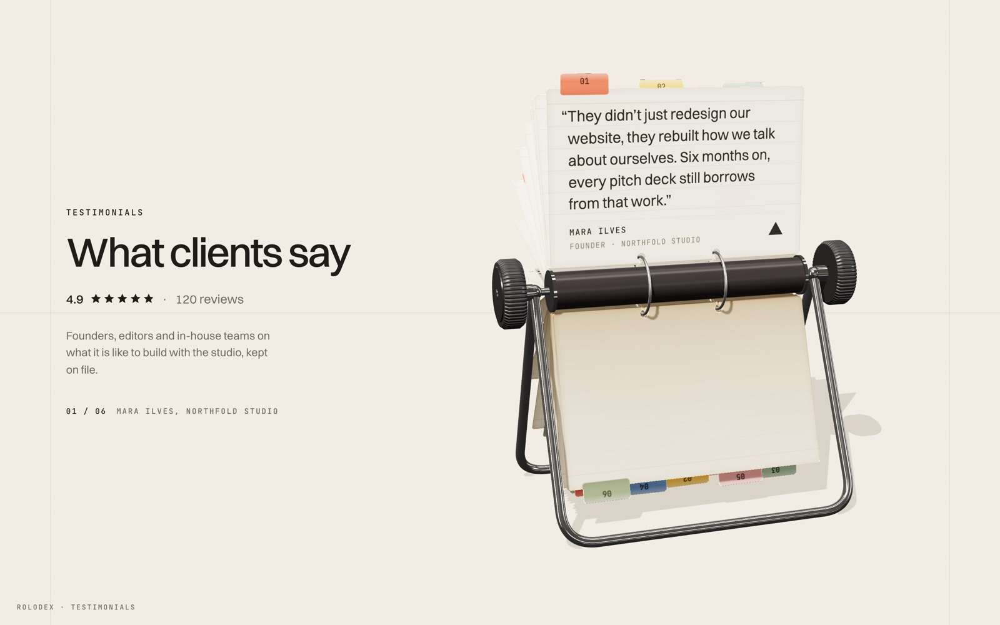

# Rolodex Testimonials

A testimonials section where the carousel is a vintage rotary card file. One HTML file, three.js, no build step.

**[Live demo](https://madebysourasith-sudo.github.io/rolodex-testimonials/)** · [demo video](media/demo.mp4)

[](https://madebysourasith-sudo.github.io/rolodex-testimonials/)

## What it does

- **Turns on its own.** One card every 3 seconds, with a small paper-flip sound. It stops while someone is using it, when it is off-screen, when the tab is hidden, and under `prefers-reduced-motion`.
- **The knobs work like a real Rolodex.** Click a knob to flip one card. Grab it and roll it: the knob is geared to the drum, so the knurl stays under your finger. Spin it hard and the cards keep rolling.
- **You can also** tap or drag the upright card, use shift-scroll or the arrow keys, or call the JS API.
- **Accessible.** The active card is mirrored to screen readers. The canvas is decorative. Arrow keys, Home and End all work.

## Use it

1. Download `index.html` (or copy everything from `<section id="testimonials">` to the end of the scripts into your page).
2. Edit the `CONFIG` object near the top of the main script:

```js
const CONFIG = {
  eyebrow: 'Testimonials',
  heading: 'What clients say',
  rating: 4.9, count: 120, countLabel: 'reviews',
  lede: 'Founders, editors and in-house teams on …',
  cardsInDrum: 24,        // physical cards on the drum
  sound: true, volume: 0.55,
  autoplay: 3000,         // ms between flips, 0 = off
  showControls: false,    // arrows + dots under the file
  testimonials: [
    { quote: '…', name: 'Mara Ilves', role: 'Founder', company: 'Northfold Studio',
      mark: 'triangle' /* ring | bars | arc | diamond | squares */, tab: '#c9573f' /* optional */ },
    // …
  ]
};
```

Quotes are fitted to the card automatically. They read best under about 190 characters.

## API and events

```js
rolodex.next(); rolodex.prev(); rolodex.go(2); rolodex.index;

document.getElementById('testimonials')
  .addEventListener('testimonialchange', e => console.log(e.detail.index, e.detail.testimonial));
```

## Notes

- It needs [three.js r128](https://cdnjs.cloudflare.com/ajax/libs/three.js/r128/three.min.js), loaded from cdnjs, and nothing else. The fonts are Switzer (Fontshare) and JetBrains Mono (Google Fonts). Both fall back to system fonts.
- Browsers only allow the sound after the visitor's first click, tap or key press.
- The testimonials, names and companies in the demo are made up.

## License

MIT. Use it in client work, change it, ship it. A credit or a tag is always appreciated.

Made by [@madebysourasith](https://neuform.ai/@madebysourasith).
